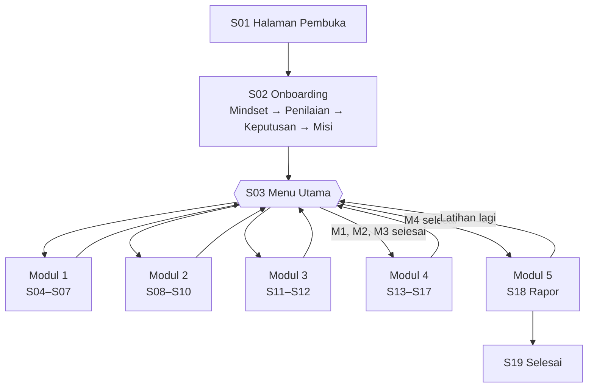

# Alur Scene

## Rincian

| Scene | Judul | Modul | Catatan |
|---|---|---|---|
| S01 | Halaman Pembuka | — | Judul huruf demi huruf, cap hanko, Navi melambai, tombol Mulai → sapuan sakura |
| S02 | Onboarding | Modul 0 | 4 layer: Mindset, Tiga penilaian, Keputusan awal di lobi (Trust Meter muncul), Misi |
| S03 | Menu Utama | Hub | Peta jalan stasiun → kantor; stempel modul selesai; saran modul berikutnya |
| S04 | Lima Blok Jikoshoukai dan Contoh Audio | 1 | |
| S05 | Kosakata dan Ungkapan Kunci | 1 | |
| S06 | Susun Jikoshoukai (Drag-and-Drop) | 1 | Aktivitas bernilai |
| S07 | Hatsuon dan Intonasi | 1 | |
| S08 | Nyuushitsu (Masuk Ruangan) | 2 | |
| S09 | Ojigi | 2 | |
| S10 | Etiket Duduk dan Persiapan | 2 | |
| S11 | Pengantar Hou-Ren-Sou | 3 | |
| S12 | Empat Studi Kasus Etos Kerja | 3 | Aktivitas bernilai |
| S13 | Pemeriksaan Modul 1–3 | 4 | Gerbang sebelum wawancara |
| S14 | Briefing dan Latihan Mendengar | 4 | |
| S15 | Masuk Ruangan dan Salam | 4 | |
| S16 | Tanya-Jawab Inti Wawancara | 4 | |
| S17 | Penutup Wawancara | 4 | |
| S18 | Rapor Kesiapan Kerja dan Latihan Lagi? | 5 | Membaca `State.data.trust` dan `scores` |
| S19 | Selesai | — | |

## Aturan buka-kunci

- Modul 1–3: selalu terbuka, urutan bebas (disarankan mulai Modul 1).
- Modul 4: terbuka bila `State.coreDone()` (M1, M2, M3 selesai).
- Modul 5: terbuka bila `State.data.done.M4`.

## Trust Meter

| Pilihan | Perubahan |
|---|---|
| Tepat | +10 |
| Kurang tepat | −5 |
| Salah | −10 |

Nilai awal 50, dibatasi 0–100. Pada aktivitas bernilai tombol **Kembali** dinonaktifkan (`back: false`) agar jawaban tidak bisa diulang.
